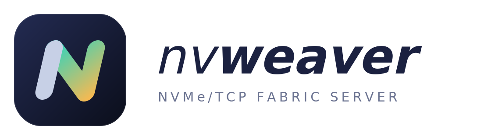

# nvweaver

<p align="center">
  
</p>

An NVMe over TCP target for test and automation labs, run from a container and
configured through a REST API.

A small control plane (one static Go binary) turns API calls into target
configuration and saves it, so it survives restarts. It is not in the data path.
Two targets can carry the I/O:

- **The Linux kernel's `nvmet`**, the default and preferred choice.
- **[SPDK](https://spdk.io)'s userspace target**, a fallback for hosts whose kernel
  has no `nvmet-tcp`, or where a container can't be privileged. Non-NVMe disks and
  files work on it too: storage stays on its normal kernel driver.

The API, saved configuration and test suite are shared, so a volume can move
between targets and hosts see the same UUID, NGUID, block size and data.

## Requirements

| | Kernel target | SPDK target |
|---|---|---|
| Image | `Containerfile`, 25 MB | `Containerfile.spdk`, 134 MB (includes both targets) |
| Host kernel | `nvmet-tcp` module (`modinfo nvmet-tcp`), which is separate from the `nvme-tcp` initiator | No NVMe modules |
| Container | Privileged, host network | Can run with `--cap-drop=ALL` |
| CPU | Any | x86-64-v2 or newer (about 2009 onward) |
| Memory | About 8 MB plus kernel use | About 240 MB (`NVWEAVER_SPDK_MEM_MB`, default 1024, is its limit) |

## Quick start

```sh
docker compose up -d --build
API=http://127.0.0.1:8420
SUB=nqn.2026-11.lab.example:vol1
HOST=nqn.2026-11.lab.example:client1

# A listener, an initiator, and a subsystem joining them.
curl -X POST $API/v1/ports -d '{"id":1,"address":"192.0.2.10","service":4420}'
curl -X POST $API/v1/hosts -d "{\"nqn\":\"$HOST\"}"
curl -X POST $API/v1/subsystems \
  -d "{\"nqn\":\"$SUB\",\"allowed_hosts\":[\"$HOST\"],\"ports\":[1]}"

# Export a device, or a new sparse file (use one or the other).
curl -X POST $API/v1/subsystems/$SUB/namespaces -d '{"device_path":"/dev/sdc"}'
curl -X POST $API/v1/subsystems/$SUB/namespaces \
  -d '{"file":{"name":"vol1.img","size_bytes":10737418240}}'
```

Without Compose, replace the first command with:

```sh
docker build -t nvweaver:dev -f Containerfile .
docker run -d --name nvweaver --privileged --network host \
  -v /lib/modules:/lib/modules:ro -v /dev:/dev -v nvweaver-data:/var/lib/nvweaver \
  nvweaver:dev
```

On a host without `nvmet-tcp`, use the SPDK image, with no privileges and only the
storage you pass in. Omit `--device` to use only service-created files:

```sh
docker build -t nvweaver:spdk -f Containerfile.spdk .
docker run -d --name nvweaver --network host --cap-drop=ALL \
  --device /dev/sdc -v nvweaver-data:/var/lib/nvweaver \
  nvweaver:spdk
```

Then run the same API calls. Run the build once and keep the image: it compiles SPDK.

On the initiator:

```sh
nvme discover -t tcp -a 192.0.2.10 -s 4420 --hostnqn=$HOST
nvme connect  -t tcp -a 192.0.2.10 -s 4420 -n $SUB --hostnqn=$HOST
```

Open the port in the target's firewall. The kernel serves discovery on every
port; add one on 8009 if your initiators expect the standard discovery port.

## What can back a namespace

| Backing | How | Notes |
|---|---|---|
| NVMe namespace | `device_path: /dev/nvme0n1` | Exported as a block device. |
| SATA, SAS, virtio, loop, and so on | `device_path: /dev/sdc` | Any block device the host has. |
| File on a volume you mounted | `device_path: /data/x.img` | Path as seen inside the container. |
| Sparse file managed by the service | `file: {name, size_bytes}` | Can be grown live. Mount a volume at the data directory, as the examples do. |
| Whole NVMe controller | `passthru_device: /dev/nvme0` on the subsystem | Hosts see the real controller. The subsystem can't have other namespaces. |

The kernel target refuses files on overlayfs, which includes a container's own
filesystem: hosts would see a disk of size zero with no device node.

On SPDK, passthrough is not available, and everything else in the table goes
through Linux AIO, so an NVMe drive gets no more speed than the kernel target gives
it. SPDK's own NVMe driver is deliberately not used, because it would take the drive
away from the kernel.

Prefer `/dev/disk/by-id/...` paths, because `/dev/sdX` names can change across
reboots. A block device that is mounted, used as swap, or held by LVM/MD is
refused, as is exporting the same device twice.

## API

JSON over HTTP. Errors are `{"error":"..."}` with status 400, 401, 404, 409
(conflict, including an address already in use) or 422 (invalid). A failed change
is rolled back, so it never leaves partial configuration.

| Resource | Methods |
|---|---|
| `/healthz` | `GET` (needs no token) |
| `/v1/system` | `GET` (includes the active `backend` and its `capabilities`) |
| `/v1/ports`, `/v1/ports/{id}` | `GET` `POST`, `GET` `PATCH` `DELETE` |
| `/v1/hosts`, `/v1/hosts/{nqn}` | `GET` `POST`, `GET` `PATCH` `DELETE` |
| `/v1/subsystems`, `/v1/subsystems/{nqn}` | `GET` `POST`, `GET` `PATCH` `DELETE` |
| `/v1/subsystems/{nqn}/ports/{id}` | `PUT` `DELETE` (idempotent) |
| `/v1/subsystems/{nqn}/hosts/{nqn}` | `PUT` `DELETE` (idempotent) |
| `/v1/subsystems/{nqn}/namespaces`, `.../{nsid}` | `GET` `POST`, `GET` `PATCH` `DELETE` |

Behaviour worth knowing:

- `PATCH` on a port drops its connections briefly, because the kernel only allows
  port changes while no subsystem is attached.
- A subsystem's serial and model can't be changed after creation, because the
  kernel freezes them once a host has identified the controller.
- Serial, UUID and NGUID are generated once and saved, so hosts see the same
  identity after a restart.
- `DELETE .../namespaces/{nsid}?delete_file=true` also deletes a managed file.
  Without it, the file is kept.
- DH-HMAC-CHAP: set `dhchap_key` (and optionally `dhchap_ctrl_key`, `dhchap_hash`,
  `dhchap_dhgroup`) on a host. Secrets are never returned by the API. They are
  stored in plain text in the mode 0600 state file.

## Configuration

| Variable | Default | Meaning |
|---|---|---|
| `NVWEAVER_LISTEN` | `127.0.0.1:8420` | API address. |
| `NVWEAVER_API_TOKEN` | none | Bearer token. Required unless the API is on loopback. |
| `NVWEAVER_DATA_DIR` | `/var/lib/nvweaver` | Saved state and managed files. |
| `NVWEAVER_KEEP_ON_EXIT` | `false` | Leave the target serving when the container stops. Kernel target only. |
| `NVWEAVER_BACKEND` | `auto` | `auto`, `nvmet` or `spdk`. `auto` uses the kernel if it can, otherwise SPDK if the image has it. |
| `NVWEAVER_SPDK_CORES` | one CPU | SPDK CPU list or mask, such as `[2,3]`. |
| `NVWEAVER_SPDK_MEM_MB` | `1024` | Memory SPDK may reserve for buffers. 256 is too little. |
| `NVWEAVER_SPDK_HUGEPAGES` | `false` | Use hugepages already reserved on the host. |
| `NVWEAVER_SPDK_POLLING` | `false` | Poll continuously: lower latency, but each SPDK core runs at 100% even when idle. |

By default, stopping the container removes the configuration from the kernel, and
starting it restores it; connected hosts reconnect by themselves. With
`NVWEAVER_KEEP_ON_EXIT=true` the kernel keeps serving with no container running,
and the next instance adopts it without disturbing hosts, which allows upgrades
with no interruption. Objects created outside this service are left alone.

## Running under systemd

For the kernel target, run the binary directly: the container adds nothing there.
This needs Go to build, and enables nothing until you ask:

```sh
make
sudo make install
sudo systemctl daemon-reload
sudo systemctl enable --now nvweaver
```

Settings go in `/etc/nvweaver/nvweaver.env`, using the variables under
[Configuration](#configuration). Configuration and managed files are in
`/var/lib/nvweaver`. `systemctl start` returns once the target and API are ready, so
units ordered after this one can rely on it. If startup fails, for example because
an address isn't up yet, systemd retries every 5 seconds for up to 5 minutes.

For the SPDK target, run the container using Podman Quadlet, which needs no build tools
beyond Podman, and no capabilities:

```sh
sudo podman build -t nvweaver:spdk -f Containerfile.spdk .
sudo make install-quadlet
sudo systemctl daemon-reload
sudo systemctl start nvweaver-spdk
```

Add an `AddDevice=` line to `/etc/containers/systemd/nvweaver-spdk.container` for each
disk it may export. It starts at boot once installed, because Quadlet units can't be
enabled or disabled; remove the file to stop that.

Worth knowing:

- **The network must really be up.** Check that your distribution's network-wait
  service is enabled (such as `NetworkManager-wait-for-online`), or use the retries.
- **Backing storage must be there too.** For files on another mount, add
  `RequiresMountsFor=/that/mount` with `systemctl edit nvweaver`.
- **The unit is sandboxed.** It can't see `/home`, so backing files can't be there, and
  `/usr`, `/boot` and `/etc` are read-only. Relax a setting with `systemctl edit nvweaver`
  if you need to. Don't add `ProtectKernelTunables`, `ProtectKernelModules`,
  `PrivateDevices` or `ProtectClock`, which stop it working.
- **`NVWEAVER_KEEP_ON_EXIT=true` also applies to `systemctl stop`:** the target keeps
  serving hosts. To stop it, remove the setting, restart, then stop.
- **`make uninstall`** keeps `/etc/nvweaver` and `/var/lib/nvweaver`. Stop and disable
  the service first.

## Differences on SPDK

Requests the SPDK target can't honour are refused with a 422, and `/v1/system`
reports them under `capabilities`:

- **No wildcard addresses.** Use a specific IP. SPDK would accept `0.0.0.0`, then
  reject every host.
- **Passthrough, `inline_data_size` and `buffered_io`** are not available.
- **`NVWEAVER_KEEP_ON_EXIT`** is refused at startup: I/O stops with the container.
  Hosts reconnect once it is back.
- **`dhchap_hash` and `dhchap_dhgroup` are accepted but not enforced per host.** The
  target and host negotiate from everything both support. Keys are enforced.
- **A crash ends the container**, so set a restart policy. The next start restores
  the configuration.

With a saved configuration that SPDK can't run, startup fails and names the setting.

Without host networking, publish the ports and create the port using the container's
own IP. Discovery then reports that IP, which hosts outside can't reach, so have them
connect directly to the published address.

## Security

This is for isolated lab networks.

- Anyone who can reach the API with its token can export any unused host block
  device. The API has no TLS, so the token travels in clear text if the API is not
  on loopback.
- NVMe/TCP traffic is unencrypted. TLS for NVMe/TCP is not implemented here.
- Host NQNs are claims, not proof of identity. Use DH-HMAC-CHAP if that matters.

## Testing

```sh
go test ./...      # needs no privileges; uses a fake configfs
./test/e2e.sh      # real target and Linux initiator over loopback
./test/bench.sh    # NVMe/TCP overhead, measured against null_blk
./test/systemd-e2e.sh  # the installed service under real systemd, in a container
```

Set `BACKEND=spdk` to run `e2e.sh` and `bench.sh` against SPDK. `systemd-e2e.sh` installs
nothing on the machine running it: `make install` runs inside a disposable container.

The last two need privileged containers. They temporarily load kernel modules and
create NVMe devices on the host, then remove them. Set `ENGINE=podman` to use Podman.

## Known limits

- NVMe/TCP only.
- The SPDK image is only built and tested for x86-64 (`SPDK_ARCH` is the build
  argument for other baselines).
- No formal NVMe conformance suite has been run. Protocol behaviour is the target's;
  the tests here exercise both with the Linux initiator only.
- **Not yet tested on physical NVMe hardware or over a real network.** All tests so
  far ran on one machine over loopback, including those for NVMe-backed namespaces.
  See [TODO.md](TODO.md) for what is deferred until hardware is available.
- Passthrough has only been tested against a fabrics-attached controller, with
  Identify. I/O through it is untested.
- No ANA groups, NVMe/TCP TLS, per-controller statistics, or API for referrals.

## More documentation

- [TODO.md](TODO.md): the roadmap, and what is deferred until hardware is available
- [docs/architecture.md](docs/architecture.md): how the pieces fit together
- [docs/decisions.md](docs/decisions.md): design decisions, and what was rejected
- [docs/testing.md](docs/testing.md): coverage, latest results and known pitfalls

## License

[MIT](LICENSE)
